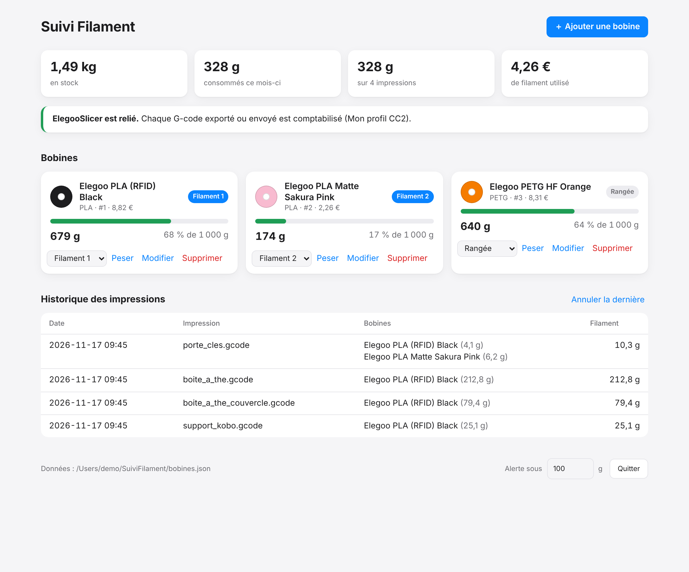
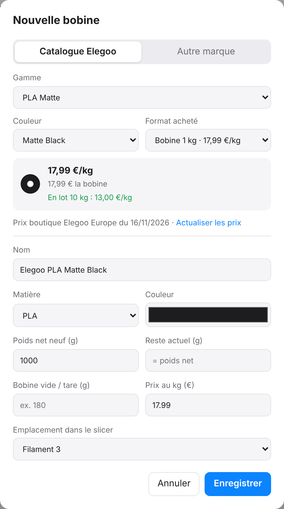
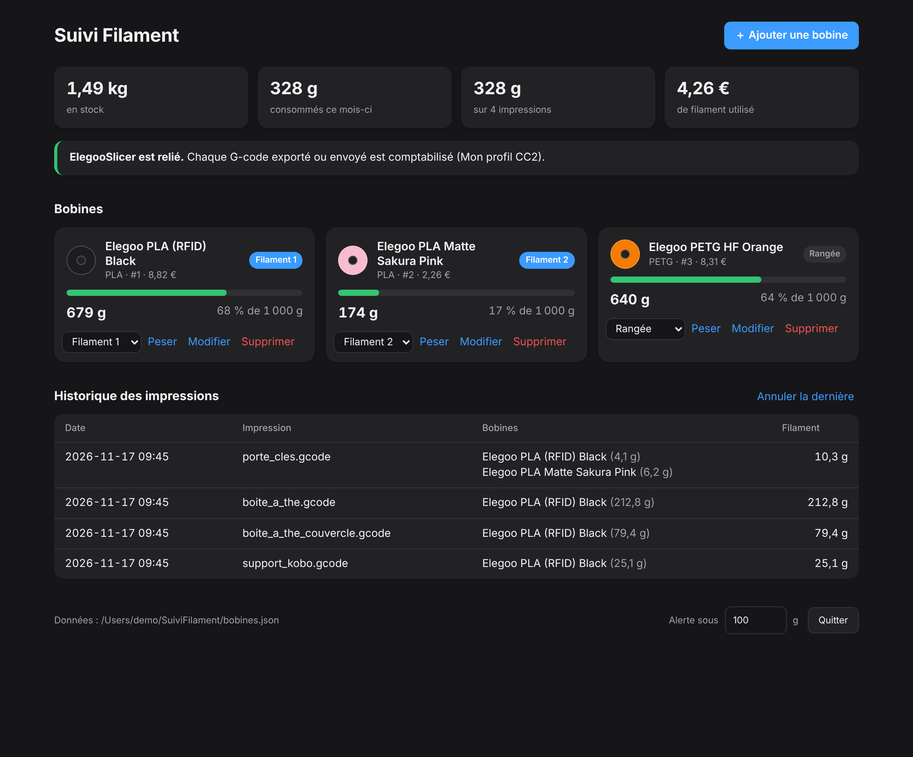

# Suivi Filament

**Gère tes bobines de filament et compte automatiquement ce que chaque impression consomme,
directement depuis ElegooSlicer.** Conçu pour l'Elegoo Centauri Carbon 2, utilisable avec
tout slicer basé sur OrcaSlicer / Bambu Studio / PrusaSlicer.



## Ce que ça fait

- **Comptage automatique** : à chaque G-code exporté ou envoyé depuis ElegooSlicer, le poids
  consommé est retiré de la bonne bobine (Filament 1 à 4, compatible Canvas multicolore).
- **Alerte avant d'imprimer** : une notification s'affiche si une bobine n'a pas assez de filament
  pour l'impression, ou passe sous un seuil (100 g par défaut).
- **Catalogue Elegoo intégré** : choisis gamme, couleur et format (bobine 1 kg, lot 5/10 kg,
  grosse bobine 3/5 kg) — nom, couleur, poids et **prix au kg** se remplissent tout seuls,
  avec les prix de la boutique Elegoo Europe, mis à jour chaque semaine.
- **Coût réel de tes impressions**, historique détaillé, pesée pour recaler le stock,
  annulation d'une impression ratée.
- **Tout reste sur ton ordinateur** : aucun compte, aucun serveur externe (seule la mise à jour
  des prix interroge la boutique Elegoo).

| Catalogue Elegoo | Mode sombre |
|---|---|
|  |  |

## Installation

Télécharge le paquet qui te convient dans la page
[**Releases**](../../releases/latest) :

| Paquet | Pour qui |
|---|---|
| `SuiviFilament-app-mac-*.zip` | **macOS, recommandé** — application avec interface graphique |
| `SuiviFilament-scripts-mac-*.zip` | macOS, version ligne de commande seule |
| `SuiviFilament-scripts-windows-*.zip` | Windows, version ligne de commande |

### macOS — application

1. Dézippe et glisse **Suivi Filament.app** dans **Applications**.
2. Premier lancement : **clic droit → Ouvrir → Ouvrir** (l'app n'est pas signée par Apple).
   Si macOS la dit « endommagée » :
   ```bash
   xattr -cr "/Applications/Suivi Filament.app"
   ```
3. L'interface s'ouvre dans ton navigateur. Python 3 est requis : s'il manque, l'app propose
   d'installer les outils gratuits d'Apple.

### Relier ElegooSlicer (une seule fois)

1. Dans ElegooSlicer, onglet **Process** : clique sur l'icône **disquette** pour enregistrer
   ton propre profil de traitement (les profils Elegoo d'origine ne sont pas modifiables).
2. **Quitte ElegooSlicer (⌘Q)** — sinon il écraserait le réglage en se fermant.
3. Dans Suivi Filament, clique sur **Relier ElegooSlicer** : le bandeau passe au vert.

Le suivi est ajouté aux **Scripts de post-traitement** de tes profils (une sauvegarde
`.bak-suivi` de chaque profil est conservée). Détails : [docs/macos-app.md](docs/macos-app.md).

### Windows / ligne de commande

Voir [docs/windows.md](docs/windows.md) et [docs/macos-scripts.md](docs/macos-scripts.md).

## Comment ça marche

ElegooSlicer (comme OrcaSlicer) peut lancer un programme à chaque G-code généré.
`suivi_filament.py` lit le poids calculé par le slicer (`; filament used [g] = …`),
le retire de la bobine active de chaque emplacement et met à jour `~/SuiviFilament/bobines.json`.
L'application lit et modifie ce même fichier via un petit serveur local
(127.0.0.1 uniquement, protégé par un jeton aléatoire).

## Dépannage : une impression n'a pas été comptée

1. Dans l'app, le bandeau doit être **vert** et indiquer « Dernier G-code reçu : … ».
   S'il dit « Aucun G-code reçu », ElegooSlicer n'a pas appelé le script.
2. Vérifie que le profil **Process** sélectionné dans ElegooSlicer est bien **ton** profil
   (celui listé dans le bandeau), pas un profil Elegoo d'origine.
3. Seules les impressions **découpées puis exportées ou envoyées depuis ElegooSlicer** sont
   comptées : un fichier relancé depuis l'écran de l'imprimante, une clé USB ou l'app Elegoo
   ne passe pas par le slicer.
4. Chaque appel du slicer est noté dans `~/SuiviFilament/post_traitement.log`.

## Limites connues

- Le comptage se fait **à l'export du G-code**, pas en fin d'impression : une impression ratée ou
  jamais lancée doit être annulée dans l'historique.
- La consommation est **l'estimation du slicer** ; une pesée de temps en temps recale le stock.
- Les couleurs du catalogue sont des teintes approximatives déduites du nom.
- Si Elegoo modifie sa boutique, la mise à jour des prix peut échouer (les derniers prix connus
  restent utilisés).
- Pistes : comptage en fin d'impression via Moonraker pour les imprimantes sous
  [COSMOS](https://github.com/OpenCentauri/cosmos) (Klipper).

## Développement

```
src/            moteur, serveur local, interface, catalogue Elegoo (Python 3.8+, stdlib seule)
macos/app/      lanceur et Info.plist de l'application
macos/scripts/  installeur et commandes Terminal (version sans interface)
windows/        raccourci bobines.bat
tests/          tests unitaires
build.py        construit les zips dans dist/
```

```bash
python3 -m unittest discover -s tests
```

```bash
python3 build.py
```

Lancer l'interface en local, sans ouvrir de navigateur :

```bash
SUIVI_FILAMENT_SANS_NAVIGATEUR=1 python3 src/serveur.py
```

Mettre à jour l'instantané du catalogue livré avec l'app :

```bash
python3 src/catalogue_elegoo.py src/catalogue_elegoo_base.json
```

## Licence

[GPL-3.0-or-later](LICENSE). Projet indépendant, **non affilié à Elegoo**. « Elegoo »,
« Centauri Carbon » et « ElegooSlicer » sont des marques de leurs propriétaires ; les prix
proviennent du catalogue public de la boutique Elegoo Europe.
